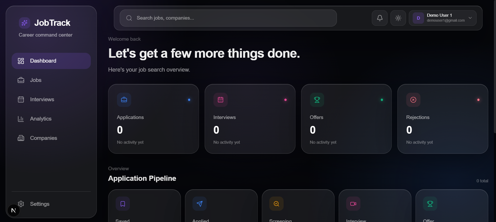
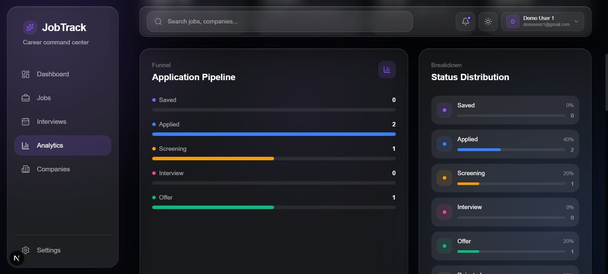
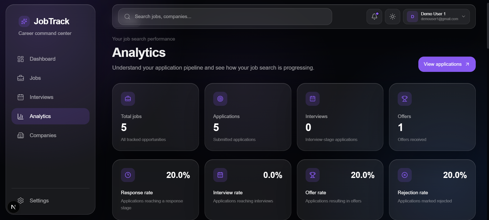
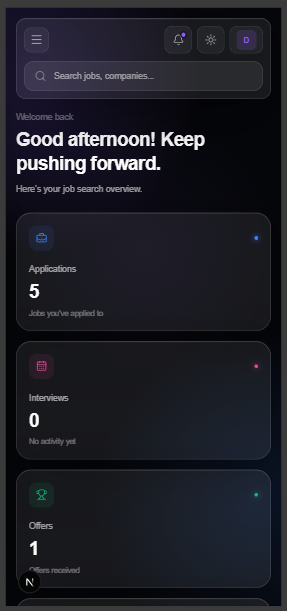

<div align="center">


<a href="https://github.com/kabadkhal/JobTrack">
  
</a>

<br />

[](https://job-track-flax-seven.vercel.app/)
[](https://github.com/kabadkhal/JobTrack/commits)
[](https://github.com/kabadkhal/JobTrack)
[](LICENSE)
[](https://github.com/kabadkhal/JobTrack/stargazers)

<br />

**[Live demo](https://job-track-flax-seven.vercel.app/)** · **[Report a bug](https://github.com/kabadkhal/JobTrack/issues)** · **[Request a feature](https://github.com/kabadkhal/JobTrack/issues)**

</div>

---

<!--
  SCREENSHOTS
  Add your images to docs/screenshots/ with these exact names:
    dashboard-dark.png, dashboard-light.png, pipeline.png, analytics.png, mobile.png
  GitHub shows the dark or light dashboard to match each visitor's GitHub theme.
-->

<div align="center">
  <picture>
    <source media="(prefers-color-scheme: dark)" srcset="docs/screenshots/dashboard-dark.png">
    <source media="(prefers-color-scheme: light)" srcset="docs/screenshots/dashboard-light.png">
    
  </picture>
</div>

<br />

<table>
  <tr>
    <td align="center"><b>Application pipeline</b><br /></td>
    <td align="center"><b>Analytics</b><br /></td>
    <td align="center"><b>Mobile</b><br /></td>
  </tr>
</table>

## About

Job hunting means juggling dozens of applications, interviews and follow-ups, and spreadsheets stop working fast. **JobTrack** is a full-stack web app that keeps all of it in one place: save every role, move it through a pipeline, track interviews, and see how your search is going with live analytics.

## Features

| | Feature | Details |
| --- | --- | --- |
| 📌 | **Application pipeline** | Saved, Applied, Screening, Interview, Offer, Rejected and Withdrawn stages |
| ➕ | **Rich job records** | Company, position, location, job type, salary, job URL, recruiter details, interview date and notes |
| 📊 | **Dashboard** | Status counts and recent applications at a glance |
| 📈 | **Analytics** | Interview, offer, rejection and response rates, monthly trends, top companies and locations |
| 🏢 | **Companies view** | Every application grouped by company |
| 📅 | **Interviews view** | Upcoming interviews with recruiter contact details |
| 🔍 | **Global search** | Find any job or company instantly |
| 🔔 | **Notifications** | Interview reminders and application updates, as a dropdown or a swipe-to-close drawer on phones |
| 🌗 | **Light and dark themes** | Saved per user, with no flash on page load |
| 📱 | **Responsive design** | Fixed navbar and layouts that work from phones to desktops |
| 🔐 | **Accounts** | Sign up, log in, update your profile and change your password |
| 🛡️ | **Admin dashboard** | Platform-wide user and job statistics, available to admins only |

## Tech stack

<div align="center">


</div>

| Area | Technology |
| --- | --- |
| Framework | [Next.js 16](https://nextjs.org/) (App Router) and [React 19](https://react.dev/) |
| Language | [TypeScript](https://www.typescriptlang.org/) |
| Database | [MongoDB](https://www.mongodb.com/) with the official Node driver |
| Authentication | [Auth.js (NextAuth v5)](https://authjs.dev/) with credentials and JWT sessions |
| Passwords | bcryptjs |
| Styling | [Tailwind CSS v4](https://tailwindcss.com/) with a CSS-variable design system |
| Motion and icons | [Framer Motion](https://www.framer.com/motion/) and [Lucide](https://lucide.dev/) |
| Hosting | [Vercel](https://vercel.com/) |


## Security

- Every API route checks the session on the server.
- Job queries are always scoped to the logged-in user's ID, taken from the session and never from the request body.
- Admin pages and admin API routes enforce the `admin` role on the server, not just in the interface.
- Passwords are hashed with bcrypt, and password hashes are never returned by any API.
- New accounts always get the `user` role.

## Getting started

### Prerequisites

- Node.js 20 or newer
- A MongoDB database (a free [MongoDB Atlas](https://www.mongodb.com/atlas) cluster works)

### Installation

```bash
git clone https://github.com/kabadkhal/JobTrack.git
cd JobTrack
npm install
```

Create a `.env.local` file in the project root (copy `.env.example`):

```env
MONGODB_URI=mongodb+srv://<user>:<password>@<cluster>.mongodb.net/?retryWrites=true&w=majority
MONGODB_DB=jobtrack
AUTH_SECRET=<generate one with: npx auth secret>
```

Start the development server:

```bash
npm run dev
```

Open [http://localhost:3000](http://localhost:3000), create an account and start adding jobs.

### Creating an admin

There is no sign-up path for admins. Register a normal account, then in your MongoDB `users` collection set that user's `role` field to `"admin"`. Sign out and back in to refresh the session.

### Scripts

| Command | What it does |
| --- | --- |
| `npm run dev` | Start the development server |
| `npm run build` | Create a production build |
| `npm run start` | Run the production build |
| `npm run lint` | Lint the code |

## Project structure

```text
app/
├── api/            Route handlers: jobs, stats, profile, admin, auth, register
├── admin/          Admin dashboard
├── analytics/      Analytics page
├── companies/      Companies page
├── interviews/     Interviews page
├── jobs/           Jobs list page
├── settings/       Profile and password settings
├── login/ register/
components/         UI: navbar, sidebar, modals, pipeline, search, notifications
context/            JobContext: client-side job state
lib/                MongoDB connection
types/              Shared TypeScript types
auth.ts             Auth.js configuration
proxy.ts            Route protection
```

## API overview

All routes need a logged-in session unless noted.

| Method | Route | Description |
| --- | --- | --- |
| `POST` | `/api/register` | Create an account (public) |
| `GET` `POST` | `/api/jobs` | List or create the current user's jobs |
| `PATCH` `DELETE` | `/api/jobs/[id]` | Update or delete one of the user's jobs |
| `GET` | `/api/dashboard/stats` | Status counts |
| `GET` | `/api/analytics/stats` | Rates, trends and breakdowns |
| `GET` | `/api/companies/stats` | Applications grouped by company |
| `PATCH` | `/api/profile` | Update name |
| `PATCH` | `/api/profile/password` | Change password |
| `GET` | `/api/admin/stats` | Platform statistics (admin only) |
| `GET` | `/api/admin/users` | User list (admin only) |

## Roadmap

- [x] Light and dark themes
- [x] Responsive layout with mobile notification drawer
- [x] Page titles that follow the current page
- [ ] Shared schema validation (Zod) for all API input
- [ ] Rate limiting on login and sign-up
- [ ] Follow-up reminders with due dates
- [ ] Drag-and-drop pipeline board
- [ ] CSV import and export
- [ ] Resume and cover letter attachments
- [ ] Automated tests and CI

## Contributing

Ideas and pull requests are welcome. Open an issue to discuss a change first, then fork the repo, create a branch, and open a pull request.

## License

Released under the [MIT License](LICENSE).

## Author

**Kartik Badkhal**

[](https://github.com/kabadkhal)
[](https://www.linkedin.com/in/kabadkhal/)

<div align="center">

If you find JobTrack useful, consider giving it a ⭐


</div>